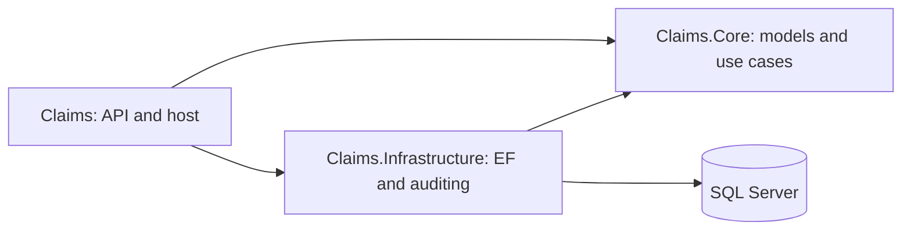

# Claims API: Interview Preparation

Use this as rehearsal notes, not a script to memorize. Explain the decisions in
your own words and be ready to walk through the code behind each claim.
The solution runs locally with SQL Server or LocalDB. Docker and Azure are not
part of the submitted implementation.

## 1. A Short Introduction

Suggested opening:

> I focused on making the business behavior correct and easy to test. I separated
> HTTP handling, application logic, and persistence into three projects. I moved
> claims and covers from MongoDB to SQL Server, added validation, corrected the
> progressive premium calculation, and moved final audit writes into a background
> worker. Business changes and pending audits commit together, so background
> processing does not introduce a gap where an audit could be lost.
>
> I kept the implementation small: focused repositories, one shared EF Core
> context, and no messaging infrastructure or additional frameworks unless they
> solved a concrete problem. The tests cover business boundaries, HTTP behavior,
> and database transactions.

## 2. What Changed and Why

| Assignment | What changed | Why |
| --- | --- | --- |
| Task 1: Refactoring | Thin controllers, application services, repository interfaces, separate projects, documentation | Responsibilities are easier to understand and test independently. |
| Task 2: Validation | Cost, date, required-field, and enum checks | Reject invalid requests before persisting changes. |
| Task 3: Auditing | Transactional SQL outbox and hosted worker | Final audit writes happen outside the request without losing pending work on restart. |
| Task 4: Testing | Unit tests, HTTP tests, relational tests, optional real SQL Server test | Verify both business rules and integration behavior. |
| Task 5: Premium | Pure calculator with three non-overlapping day bands | Fix repeated charges for the same day and make pricing rules explicit. |

The template's controllers handled persistence, auditing, and pricing directly.
The original pricing conditions overlapped, so the same day could be charged
multiple times. These were the main problems to address, not just folder names.

## 3. Architecture Walkthrough



These arrows represent dependencies, not the order of every runtime call.

- **Claims:** controllers, HTTP error mapping, dependency registration, worker hosting.
- **Claims.Core:** entities, request contracts, services, pricing, repository and unit-of-work interfaces. No EF Core or ASP.NET Core dependency.
- **Claims.Infrastructure:** EF context, repository implementations, migrations, audit storage and processing. Depends on Core.
- **Claims.Tests:** isolated unit tests and integration checks.

The API references Infrastructure to wire implementations to interfaces in
[Program.cs](../Claims/Program.cs). Controllers depend on `IClaimService` and
`ICoverService`, not concrete application service classes, and do not use the
database context. Core owns both service and repository contracts, so the API
and application services can be tested or replaced without depending on the
concrete implementation project.

### Why three production projects?

Separate assemblies enforce the dependency direction at compile time. Keeping EF,
repositories, and audit persistence together avoids a separate project for every
technical folder. This is a small layered application, not a microservice system.

### Why repositories when EF already provides similar abstractions?

EF Core already provides change tracking and unit-of-work behavior. The focused
repositories isolate queries and give service tests a small substitution point;
they do not attempt to rebuild EF through a large generic repository.

[ClaimRepository.cs](../Claims.Infrastructure/Persistence/ClaimRepository.cs)
contains claim queries. Repository methods do not commit independently.
[ClaimsDbContext.cs](../Claims.Infrastructure/Persistence/ClaimsDbContext.cs)
implements `IUnitOfWork`, allowing the service to commit a business change and its
pending audit together.

## 4. Walk Through One Request

Use [ClaimService.cs](../Claims.Core/Application/ClaimService.cs) to explain claim creation:

1. The controller accepts a request DTO, not a client-supplied persisted entity.
2. The service validates cost, name, and claim type.
3. It asynchronously loads the related cover through `ICoverRepository`.
4. It checks that the claim date falls within the cover period.
5. It adds the claim and enqueues an audit event on the shared context.
6. One `SaveChangesAsync` commits both records atomically.
7. The controller returns `201 Created` with a resource location.
8. The background worker later creates the final audit record.

Cancellation tokens flow through asynchronous controller, service, repository,
and database calls. There are no blocking `.Result` or `.Wait()` calls in this flow.

**Be precise:** request DTOs exist, but responses still use `Claim` and `Cover`
entities. Dedicated response DTOs are a useful next improvement, not something
already implemented.

## 5. Business Rules and Assumptions

Some requirements were explicit; others needed a documented interpretation.

| Topic | Current decision |
| --- | --- |
| Damage cost | Between 0 and 100,000 inclusive; at most two decimal places. |
| Claim date | Must be within an existing cover's period. `Created` is the supplied business date, not the audit timestamp. |
| Cover boundaries | Start included, end excluded: `[StartDate, EndDate)`. |
| Cover start | Today or later, using UTC to determine today. |
| Maximum duration | One calendar year using `AddYears(1)`, not a fixed 365 days. |
| Leap day | February 29 plus one year becomes February 28. |
| Date format | `DateOnly`, serialized as `YYYY-MM-DD`; an intentional change from the template's timestamps. |
| Cover deletion | Rejected with 409 while claims reference it. |
| Invalid enums | Rejected rather than silently using default pricing. |

Explain that exclusive end dates and calendar years are assumptions you would
confirm with the product owner. Tests document the selected behavior.

Validation uses data annotations for request shape and application services for
business rules. The cover lookup is awaited in the service. FluentValidation is
not used or required by the assignment.

## 6. Explain the Premium Calculation

Open [PremiumCalculator.cs](../Claims.Core/Application/PremiumCalculator.cs).

The calculator is static and pure: the same inputs produce the same result, with
no database, clock, or mutable state. It is not injected through an interface.
An interface would be useful if interchangeable pricing policies were needed;
it is not necessary to unit-test this deterministic calculation.

The base daily rate is 1250. Object multipliers are 1.1 for yachts, 1.2 for
passenger ships, 1.5 for tankers, and 1.3 for other defined types.

| Band | Number of days | Yacht rate | Other rate |
| --- | --- | --- | --- |
| First | At most 30 | 100% | 100% |
| Second | Next 150 | 95% | 98% |
| Third | Days beyond 180 | 92% | 97% |

The discount applies only to its band, never retroactively to the whole period.
"Additional" is interpreted as percentage points, not compounded percentages.
Money uses `decimal`, and the final total is rounded to two decimals, midpoint
away from zero.

### Example: 181-day yacht cover

```text
Daily rate:       1250 x 1.10 = 1375
First 30 days:      30 x 1375        =  41,250.00
Next 150 days:     150 x 1375 x 0.95 = 195,937.50
Remaining 1 day:     1 x 1375 x 0.92 =   1,265.00
Total:                                238,452.50
```

The calculator returns zero for a zero-day input, while the cover service rejects
zero-duration insurance. Calculation and creation eligibility are separate concerns.

## 7. Explain Background Auditing

Read [AuditWorker.cs](../Claims/AuditWorker.cs) and
[AuditProcessor.cs](../Claims.Infrastructure/Auditing/AuditProcessor.cs).

The request saves a pending event in `AuditOutbox` alongside the business change.
The worker reads pending events and, in another transaction, inserts the final
audit record and deletes its outbox row. A failed transaction leaves the event
available for retry. Unique event IDs on the audit tables prevent duplicate
final records for the same event.

The worker creates a fresh dependency-injection scope for each attempt. A hosted
worker is a singleton, while `DbContext` is scoped and not thread-safe, so the
context is resolved through that scope rather than injected into the worker.
Failures are logged and retried after one second.

### Why not just SaveChangesAsync or Task.Run?

- `SaveChangesAsync` avoids synchronously blocking a thread, but awaiting a final
  audit insert would still delay the response.
- Unobserved `Task.Run` work can outlive request-scoped dependencies or disappear
  when the process stops. It is not durable message processing.
- An in-memory channel would be smaller, but queued events could be lost on restart.
- Service Bus could help separate applications exchange messages, but adds cloud
  configuration that this single-application exercise does not need.

**Do not claim auditing is free or entirely outside the request.** The request
still awaits the business transaction and outbox insert. It does not await the
final audit write. A pending event is durable only after that transaction commits.

**Do not claim universal exactly-once delivery.** The local SQL transaction and
unique event IDs protect these database writes. Calling an external service later
would require another delivery and idempotency design.

Current limitations: one application instance, polling, no dead-letter handling,
and a permanently invalid first event can block later events. A production system
would need backlog monitoring, retry backoff, retention, and worker coordination.

## 8. Persistence and Error Handling

### Why replace MongoDB with SQL Server?

Claims already relate to covers, and auditing already used SQL Server in the
template. One database gives us foreign keys and a transaction covering business
data and pending audits. It also matches the stack I can confidently explain and
maintain. MongoDB was not inherently wrong; simplifying this use case was the choice.

The database has a cover foreign key, restricted deletion, explicit decimal
precision, and selected check constraints. Cross-record date rules remain in the
service; not every business rule is duplicated as a SQL constraint.

This is a fresh-database migration, not a MongoDB data-import solution. Existing
production data would require a separately planned and verified migration.

### Why IExceptionHandler instead of custom middleware?

[ApiExceptionHandler.cs](../Claims/ExceptionHandling/ApiExceptionHandler.cs) plugs
into ASP.NET Core's built-in exception middleware. It maps application error
categories to 400, 404, or 409 ProblemDetails responses. Selected database
constraint/concurrency failures are translated by Infrastructure into a Core
`BusinessException`; the handler does not inspect EF Core or SQL Server types.
Unknown exceptions are left to the framework's configured error pipeline; they
are not reported as success.

This centralizes HTTP translation without repeating try/catch in every controller.
Registering an exception handler is not evidence that the application has a full
optimistic-concurrency strategy; no row-version mechanism is implemented.

## 9. Testing: What Each Level Proves

| Test group | What it checks | What it does not prove |
| --- | --- | --- |
| Calculator unit tests | Exact yacht prices and pricing-band boundaries; other types; invalid input | Complete coverage of every duration or policy interpretation. |
| Service unit tests | Rules and audit decisions using NSubstitute and a fixed clock | Real EF queries, SQL constraints, or transactions. |
| HTTP integration tests | Routing, JSON binding, statuses, validation responses, workflows | The SQL Server provider's exact behavior; these use SQLite. |
| Audit relational tests | Atomic rollback, pending-event processing, retry after failure, unique event IDs | Multi-instance workers or a real process-crash test. |
| Offline SQL migration test | Model/snapshot consistency and generated SQL Server schema | Actually executing SQL against a server. |
| Real SQL Server test | Applying migrations, persistence, audit processing, foreign-key protection | Full end-to-end HTTP traffic against SQL Server. |

The suite currently has 65 cases. With no SQL test connection configured, the
expected result is 64 passed and one skipped. All 65 have passed with LocalDB
configured. Rerun before the interview rather than relying on an old test count.

One honest improvement: non-yacht pricing tests derive expected values using a
formula similar to production. Independent expected-number cases would be
stronger. Exact days 10, 150, and 365 are useful additional cases; the key 30/31
and 180/181 boundaries are already covered.

## 10. A 10-Minute Presentation

1. **One minute:** explain the original problems and the goals.
2. **Two minutes:** show project dependencies and follow a claim creation request.
3. **Two minutes:** show the pricing bands, the 181-day example, and boundary tests.
4. **Two minutes:** explain the outbox transaction and scoped background worker.
5. **Two minutes:** demonstrate successful and rejected requests in Swagger.
6. **One minute:** show tests and acknowledge the next improvements.

Avoid opening every file. Start with services, calculator, context, and audit
processor; use the controllers to demonstrate how little HTTP-specific code remains.

## 11. Local Demo Checklist

### Prepare before the call

Run the setup in the [README](../README.md). Confirm your LocalDB instance exists,
the migration is applied, and the HTTPS development certificate is trusted.
Keep database passwords and other secrets out of screen sharing.

```powershell
dotnet test Claims.Tests/Claims.Tests.csproj

# Optional real SQL Server test; requires create-database permission.
$env:CLAIMS_TEST_SQLSERVER = $env:ConnectionStrings__MainConnection
dotnet test Claims.Tests/Claims.Tests.csproj

dotnet run --project Claims
```

The connection environment variable above must first be set as shown in the
README. The SQL test creates and drops its own uniquely named database, not your
demo database. Prepare a clean demo environment without deleting data you need.

### Show the workflow in Swagger

Use future dates when rehearsing. This sample remains valid only until its
start date becomes the past; adjust both dates while retaining a 31-day difference.

Create a cover:

```json
{
  "startDate": "2028-01-01",
  "endDate": "2028-02-01",
  "type": "Yacht"
}
```

Expect `201 Created`, a Location header, and premium `42556.25`. Copy the returned
ID and create a claim:

```json
{
  "coverId": "replace-with-the-created-cover-id",
  "created": "2028-01-10",
  "name": "Collision damage",
  "type": "Collision",
  "damageCost": 100000
}
```

Then demonstrate:

1. Read the claim and cover by their returned IDs.
2. Submit cost `100000.01`: expect 400 with a field error.
3. Submit a claim on the cover end date: expect 400.
4. Delete the cover while its claim exists: expect 409.
5. Delete the claim, then the cover: expect 204 for each.
6. Read the deleted claim: expect 404.

If showing the database, use your SQL viewer to inspect `ClaimAudits` and
`CoverAudits`. The worker may consume pending rows too quickly to see them in
`AuditOutbox`; that is expected. Audit timestamps record UTC event creation time.
There is no audit-read HTTP endpoint.

## 12. Questions to Rehearse

**How does the solution apply SOLID?**
Controllers handle HTTP, services coordinate use cases, and repositories handle
persistence. Core depends on small interfaces rather than EF implementations.
There is no need to invent an inheritance hierarchy to demonstrate every principle.
One type per file is a navigation convention, not the definition of SRP.

**Why not use interfaces for every service?**
Repository substitution is useful for isolated service tests. The small concrete
services and pure calculator do not need interfaces just for symmetry. Add one
when a real substitution or boundary requirement appears.

**Why no sealed classes?**
Preventing inheritance was not a requirement. The solution uses ordinary classes;
neither using nor omitting `sealed` is itself proof of SOLID compliance.

**Why return entities if request DTOs are separate?**
Input contracts prevent clients from choosing IDs or premiums. Output models are
still coupled to entities. I would add response DTOs to stabilize the public API
as the schema grows; I would not claim that work has already been done.

**What if a cover is deleted while another request creates a claim?**
The service checks improve error messages, but cannot eliminate every race. The
foreign key is the final integrity guarantee. A conflicting operation fails rather
than creating an orphan claim, and the API maps the selected constraint failure to 409.

**What if the client disconnects after the transaction commits?**
Cancellation cannot undo a completed commit. A retry could create another claim
because request-level idempotency is not implemented. Audit-event uniqueness is
not the same as making the create API idempotent.

**What would you improve next?**
First, response DTOs and independent pricing expectations. Before public
deployment: authentication, authorization, pagination, secret/configuration
management, dependency review, and operational monitoring. For larger audit
traffic: retry/dead-letter handling and multi-worker coordination. Choose based
on requirements rather than adding all of them to the exercise.

**How did you use AI?**
Describe the assistance honestly. Be prepared to explain and defend each change,
including the date assumptions and the extra complexity of the durable outbox.
Do not present suggested future work as completed implementation.